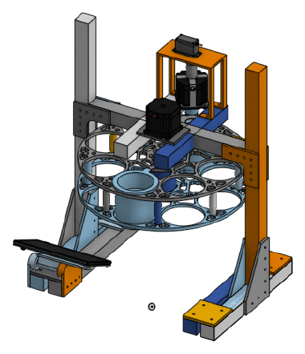
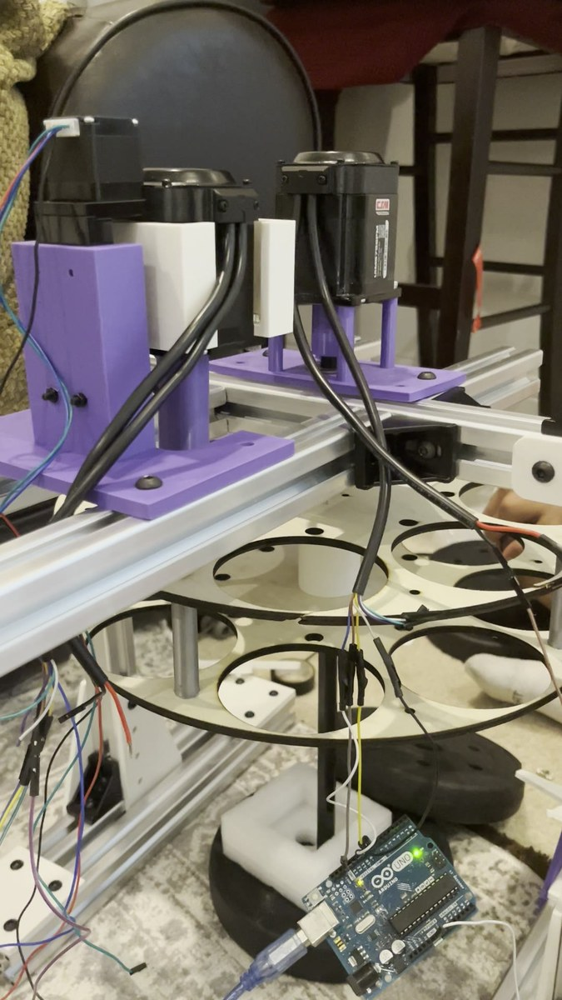

# 052 — The assembly in CAD, again

**Date:** 2026-11-08
**Milestone:** M5 → Final
**Type:** Achievement

## What I'm doing

Back in CAD, checking the assembly one more time before the final code push. The machine on the desk and the machine in CAD have been drifting apart all summer. Every printed fix adn rewired board moves the real thing a little further form the model. And this is when I close that gap, because the final code is about to be written against this exact geometery and it has to be right.

## What happened

The screen shows the assembly, the orange actuator column, the funnel and hopper, the frame, the whole machine modeled with the parts as tehy are now. And this is the version of the CAD that matches the machine, kinda, not the older version that matched the plan. And the difference between those two versions is the whole summer, lol.

the drift is the story of the whole summer. The disk got heavier than the CAD said, the electronics moved from a PCB plan to a half breadboard in a printed mount, the wire covers got added the coupler got serrated teeth, and their were always more parts to build than time to model them. And every one of those changes moved the real machine away from the model, and none of them got modeled at the time, because modeling takes time and building was faster. And this is when I pay that debt back, because the final code is about to be written against this exact geometry. And the actuator positions, the disk slots, the scale position, all of it has to be right in the modle, or the code that reads the model will be wrong about the machine. And that is nto a mistake I want to find out about on demo day.

The section cut is the view that shows whether the model is honest. The carousel, the actuator column, the frame, cut open. And if something in there was still the older version it would show, and it doesnt. The model and the machine agree agian, and i checked it the slow way, piece by piece, lmao, because a a diagnal cut through the wrong geometry would of been worse than no check at all.

## Today's results

Assembly CAD updated to match the built machine. The model and the machine agree again. Which matters because the final code is about to be written against this exact geometry. And for once the model isnt lying about anything.

## What's still left to do next time

The final code. Three pieces, Pi app, dispenser program, Arduino sketch, plus the disk positioning question the M4 notes got wrong that the code is going to have to gte right. And thats the big one, the rest is just typing.

**Total time spent: 3 hours**
