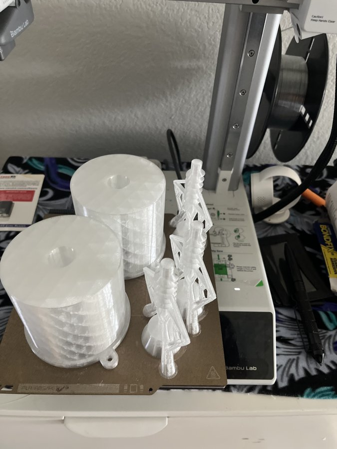
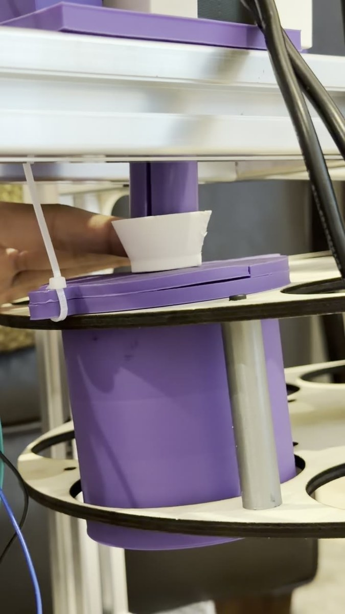
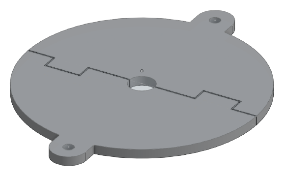

# 053 — Printing the last hopper parts

**Date:** 2026-11-11
**Milestone:** Final
**Type:** Achievement

## What I'm doing

Printing the last of the hopper parts. Eight hoppers means eight of everything, and the the print queue has been running all summer. Adn these are the final pieces, which feels strange to say after a whole summer of it never being empty.

## What happened

The photo form today is the print bed wtih the finished parts, stacked white cylindres, the hopper bodies, and the latice pieces beside them. Clean prints, no spaghetti this time, lol. And the process is reliable now in a way it wasnt before, and the spaghetti failure feels like a different project. Which in a way it was, that was before i figured out the process.

The reliability is the result here. At the start the auger wouldn't stick to the bed without glue, then a print turned into spaghetti, then the disk printed clean, then eight hopper bodies print clean in one run. And the process got reliable the same way everything else in this project did, by failing, figuring out why, and fixing the actual cause instead of hoping. glue on the bed, first layer watched, bed prep checked before a long print. None of it is exciting, and all of it is the reason the last parts printed clean. And dont let anyone tell you bed prep is boring, its what makes the prints come out clean, lmao.

Eight of everything means eight hopper bodies, eight lids, eight agitators, eight augers, and that takes alot of printing over the summer. And the machine has all of them now, and nothing left in the print queu, and the print queue being empty is a strange feeling after a summer of it never being empty. And after all that printing the last thing I wanted was a bad batch at the end, and an effecient print run means nothing if the parts dont fit.

## Today's results

Final hopper parts printed. The machine has all eight hoppers, all eight agitators, lal eight augers, and nothing left in the print queue.

## What's still left to do next time

The code. The final Arduino sketch and the Pi programs, and the disk positioning decision that changes everything abotu how the machine finds its slots. And thats the last big decision before the demo.

**Total time spent: 3 hours**
