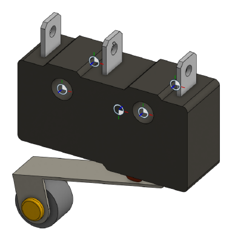
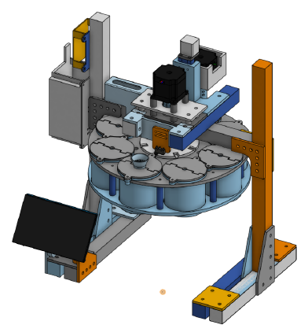
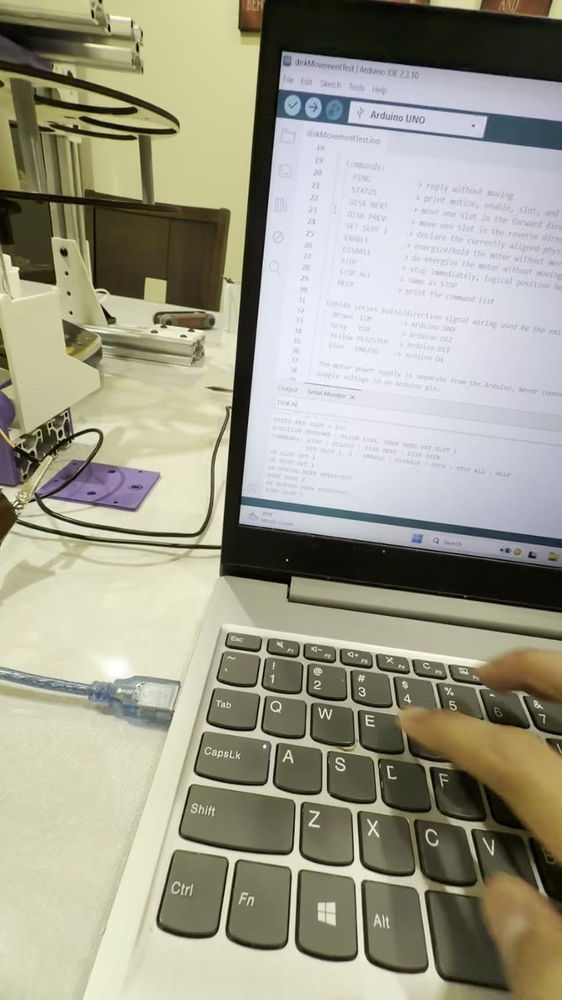

# 054 — The disk doesn't trust steps anymore

**Date:** 2026-11-14
**Milestone:** Final
**Type:** Achievement

## What I'm doing

The final code, and the biggest change of approach in the whole project. The M4 notes said the disk would run on fixed steps, 6,400 steps divided by 8 slots, taking the shortest route in either direction, and the final code does the opposite. And it's the opposite for a good reason. Steps lie.

## What happened

Steps lie lol. A stepper motor can miss steps under laod, and if disk's position is just a count of steps sent, one missed step means every slot after it is wrong, and the machine doesnt know about it. A silent error that compounds. And the fix is to stop trusting steps and start trusting a physical switch. theres a mechanical detent switch on the disk, wired to pin D2, and the disk moves clockwise only, counting detents as they click past until it reaches the slot it wants. And the position is real, measured by the swtich.

The final Arduino sketch says it plainly in its own header:

```
Auger: STEP D9, DIR D8, ENABLE D10.
Disk:  STEP D11, DIR D12, ENABLE D4.
Mechanical switch: COM -> GND, NO -> D2.
ALL disk travel is clockwise only.
DISK PREV is intentionally rejected.
```

Clockwise only, no reverse, no shortest path, no step counting. The disk goes around until the switch says it's home, and if the indexing fails the stored position is invalidated instead of guessed at. And it's slower than the shortest-path idea and it's correct. Which is what matters when the machine is dispensing actual doses, tbh.







Why the M4 plan was wrong comes dwon to what a missed step costs. In the M4 notes the disk motor has 6,400 steps per revolution, 800 steps per slot, and the disk takes the shortest route. And that's elegent, and it's fragile, because the position is a count in the code's memory, and the code's memory is only right if evrey step happened. And under load, a heavy disk, eight hoppers, friction, steps get missed, and the count drifts, and the drift is silent, and the machine thinks it's at slot 3 and it's at slot 4, and it dispenses the wrong powder inot the right dose. And the detent switch fixes it by making the position physcial. The switch clicks when a slot passes, the code counts clicks, and if the clicks don't add up the position is invalidated instead of guessed at. And the expected pitch is 800 steps per slot, wtih 400 to 1,200 allowed. Which is the code admitting that steps are approximate and the switch is what counts. And the componenets didnt change, the switch was always there. i jsut wasnt listening to it.

The other change is clockwise only. The shortest-path idea meant the disk could go either direction, which meant the code had to track direction, and direction is another thing to get wrong. And clockwise only means the disk always goes the same way, the switch always clicks in the same order, and there's exactly one way to get from any slot to any other slot. Forward, slower, simpler, Correct, lmao.

## Today's results

Final disk positioning. Clockwise-only detent indexing via the D2 switch, 800 steps expected per slot, 400 to 1200 allowed, position invalidated on indexing error, and the M4 step-counting plan is superseded. And this is the version that runs.

## What's still left to do next time

The rest of the final code, the Pi app and the dispenser program, and getting all three pieces talking to each other the way the emails show them. And then the demo, which is tomorrow, so theres not much time left to get this wrong.

**Total time spent: 5 hours**
