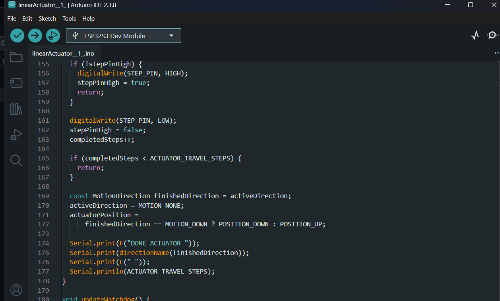
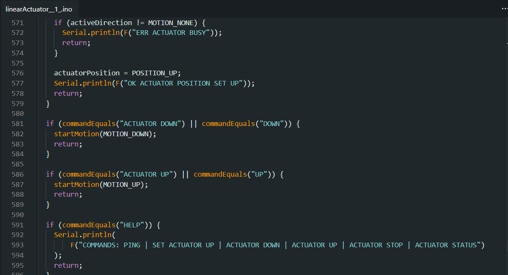

# 055 — The final code: three pieces

**Date:** 2026-11-17
**Milestone:** Final
**Type:** Achievement

## What I'm doing

The final code, all three pieces, sent bakc and forth by email today. This is the software the machine runs, and it's the same architecture the M2 split started, grown up. And im writing this one down carefully because this is the version that that has to work tomorrow, omg.

## What happened

three pieces, each with one job. They dont step on each other, they each own one thing and they do it well. **app.py, on the Pi.** A CustomTkinter dark interface, 800×480 fullscreen, titled "Compounding Doser", it owns the recipes and the positioning, it passes the Arduino port and the current disk slot to the programs it calls, and it logs everything to CSV. And this is the screen the user touches, so it has to be the part that makes sense to a person, not jsut to me.

**motor_scale_controller.py, on the Pi.** Dispenses one powder to a target using scale feedback, you call it like `python3 motor_scale_controller.py 5.0 "Cornstarch"` and it handles that one powder, that one target, and nothing else. It doesn't move the actuator, it doesn't touch the disk, one powder, one target, scale watching. And splitting it out like this means one powder at a time is testible, and the app owns the recipe while the dispenser just does the one powder it is asked for.

**The Arduino sketch, on the Uno/Nano.** Auger on Timer1, disk detent indexing on Timer2 with the D2 switch, and the linear actuator on a TMC2209. And the rules are strict and they're written in the header. The actuator must be raised before any disk command, no simultaneous motions, the actuator's position is tracked in software only, there are no limit switches, and the disk is clockwise only. And bench values are 1,000 steps per second, 4 ms debounce, and those numbers are the ones I measured, not the ones I hoped for.

```
Auger: STEP D9, DIR D8, ENABLE D10.
Disk:  STEP D11, DIR D12, ENABLE D4.
Mechanical switch: COM -> GND, NO -> D2.
ALL disk travel is clockwise only.
DISK PREV is intentionally rejected.
```





The three pieces was the M2 split, grown up. At first there were two programs, the app and the dispenser, now there are three, because the disk and the actuator need a brain of their own, and that brain is the Arduino sketch. And the app owns the interface and the recipes, the dispenser owns one powder and one target, the sketch owns the motors, the actuator, and the disk position. And each piece does one job, each piece is testable on its own, and the boundries beteween them are single calls with single values in them. And it's the same architecture from the start, the split was right the first time.

The strict rules in the sketch header are the safety of the whole machine written down. Actuator raised befor any disk command, because a lowered motor and a spinning disk would tear the coupler apart. No simultaneous motions, because two things moving at once is two things that can collide. Actuator position tracked in software only, because there are no limit switches on the actuator, which means the code has to remember where it is, and if it forgets, it has to be told. Disk clockwise only, because the detent switch only works in one direction. And these are the rules the machine runs by, written in the code itself, and im glad they are written down, because tomorrow I will be nervous and the code will not be.

## Today's results

Final software complete and exchanged. Pi app plus dispenser program plus Arduino sketch, with the pin map, the detent protocol, and the safety rules all written down in the code itself. And the machine's brain is done which is a strange thing to rite after a whole summer of it not being done.

## What's still left to do next time

Demo day, the machine on a table, eight hoppers, and an audience, and everything from the start to nwo gets proven in one afternoon. And I hope it works lol, because there is no version 4 of this day.

**Total time spent: 5 hours**
