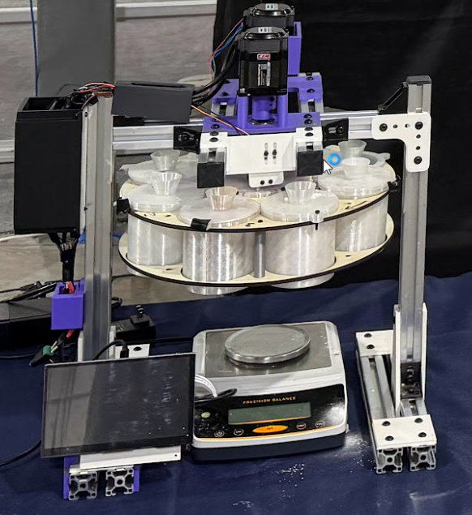

# 056 — it works end to end

**Date:** 2026-11-20
**Milestone:** Final
**Type:** Working result

## What I'm doing

Doing final tweaks on the machine, the carasoul rotation got fixed earlier now I need to do some test runs to make sure it works correctly and then test all the powders again and see if it dispenses accurately.

## What happened

The finished machine, two-level carousel wtih eight clear PETG hoppers on top, lids and funnels in place, two big black motors on purple mounts over the disk, the 3030 extrusion frame holding it all, the touchscreen at the base, and a black electronics box with PHARMATECH printed on it. I had to make sure there were no mechanical clearances and I tidied up the wires some more. I also tried making the ui a bit smoother.

After finally fixing all these issues with ethier dispensing the amount of turns the motor takes to dispense correctly, how many rotations the disc has to do, all these electrical issues, im proud to say the machine finally fully works!

## Today's results

Machine works end to end, I was also able to show to some of my friends.

## What's still left to do next time

The next version, small-dose accuracy, for one, but thats a different log. This one ends here, with a machine that works, and it works bc of a whole summer of parts that didnt. Which is a seperate kind of ending than I expected back when I started

**Total time spent: 4 hours**
